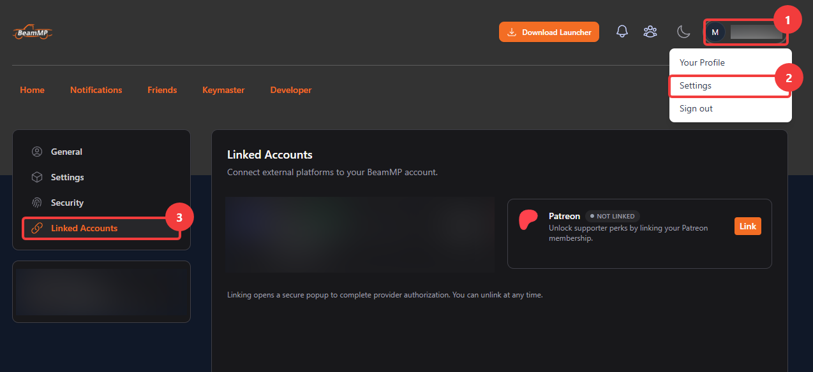
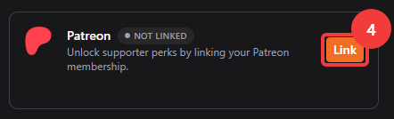
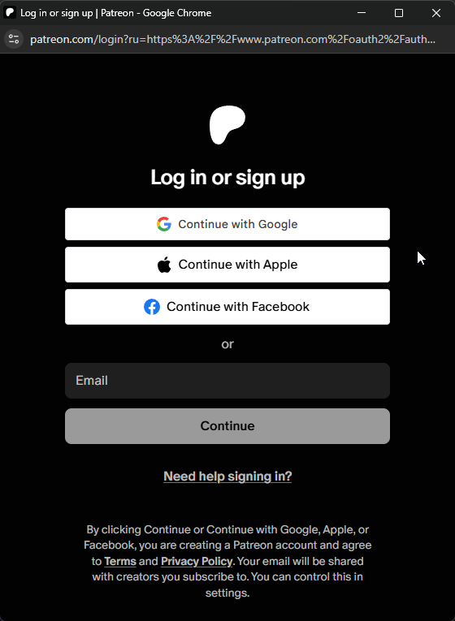
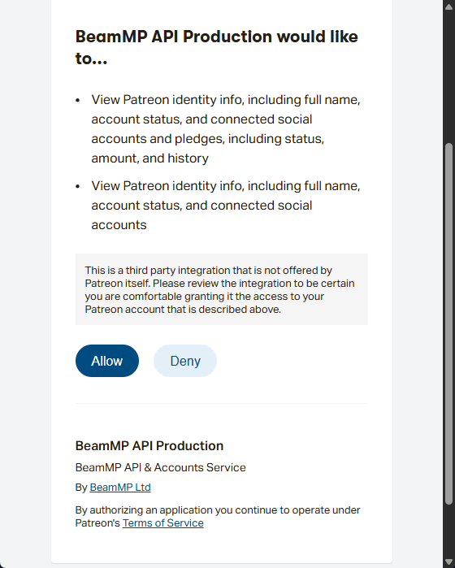
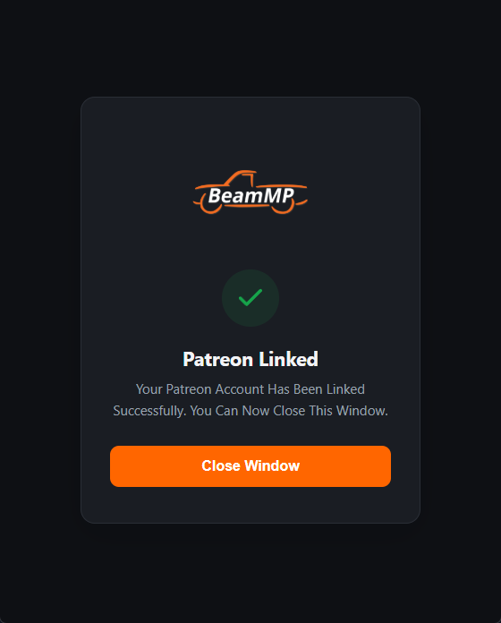
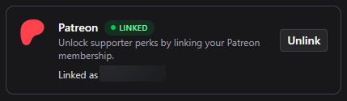

# Link Your Patreon Account

This page is for Patreon supporters. When you finish, your Patreon membership is linked to your BeamMP account and BeamMP gives you your perks. For what the perks are, see [Patreon and Early Access](/en/players/patreon-and-early-access).

## Before you start

- You need a BeamMP account with a verified email address. See [Your BeamMP Account](/en/players/account).
- You need an active membership on [BeamMP's Patreon page](https://patreon.com/BeamMP).

## Link Patreon

1. Sign in to [BeamMP Accounts](https://accounts.beammp.com).
2. Open the [Linked Accounts](https://accounts.beammp.com/app/profile/linked-accounts) page. You can also click your username in the top right (1), click **Settings** (2), and click **Linked Accounts** (3).

   

3. In the **Patreon** box, click **Link** (4). A Patreon window opens.

   

4. If Patreon asks you to sign in, sign in with the Patreon account that has your BeamMP membership.

   

5. Patreon asks if **BeamMP API Production** can see your Patreon identity and membership. Click **Allow**.

   

6. The window shows **Patreon Linked**. Click **Close Window**.

   

The **Patreon** box now shows **LINKED** and **Linked as** with your Patreon name. BeamMP gives you your perks based on your membership tier.

::: tip
If no window opens when you click **Link**, your browser blocked the pop-up. Allow pop-ups for `accounts.beammp.com` and click **Link** again.
:::

## Get your Discord roles

Linking Patreon in BeamMP Accounts gives you your perks in BeamMP. Your roles in the BeamMP Discord server come from Patreon itself.

1. Open the [Patreon Discord settings](https://www.patreon.com/settings/apps/discord).
2. Connect your Discord account there.

## Unlink Patreon

1. Open the [Linked Accounts](https://accounts.beammp.com/app/profile/linked-accounts) page.
2. In the **Patreon** box, click **Unlink**.

You can link the same or another Patreon account again at any time.

## Problems

### Patreon failed to link

If the Patreon window shows an error, or the **Patreon** box still shows **NOT LINKED** after you finish, try these:

- Check that you signed in to the Patreon account that has your BeamMP membership.
- Close the Patreon window, reload the [Linked Accounts](https://accounts.beammp.com/app/profile/linked-accounts) page and click **Link** again.
- If you still cannot link Patreon, create an **Account Support** ticket on [Discord](https://discord.gg/beammp), or send BeamMP a message on [Patreon](https://patreon.com/BeamMP).

### My Patreon account is linked to another BeamMP account

One Patreon account can be linked to one BeamMP account. Sign in to the other BeamMP account and unlink Patreon there. Then link it to this account.

### My perks have not arrived

See [My perks have not arrived](/en/players/patreon-and-early-access#my-perks-have-not-arrived).
