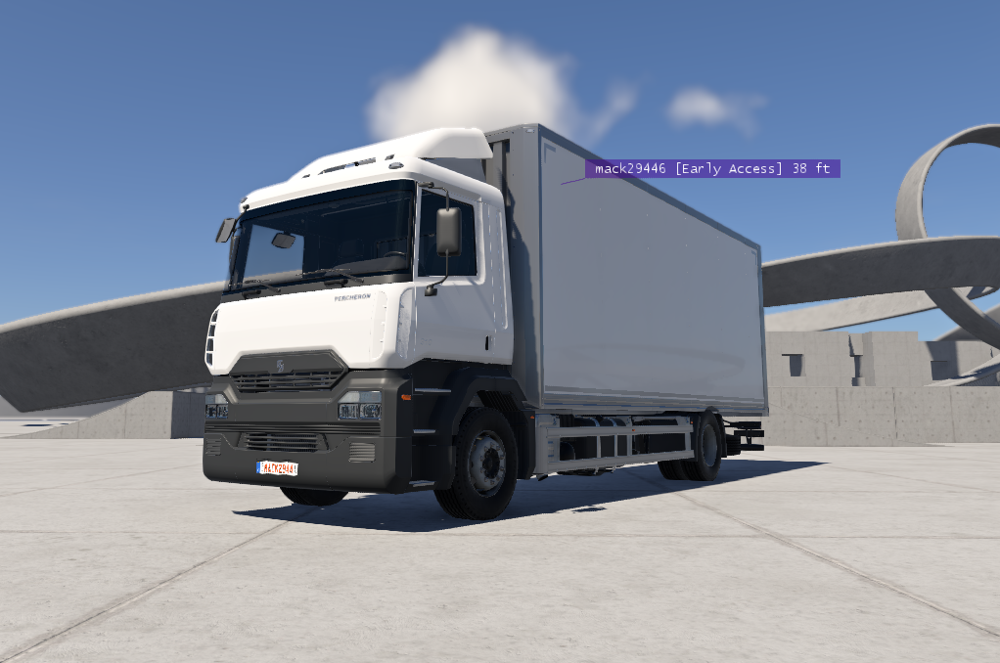

# Patreon and Early Access

This page is for players who support BeamMP, or want to. It explains what each kind of support gives you.

## Ways to support BeamMP

You get early access and extra server keys by supporting BeamMP financially.

- **Patreon:** a tier on [BeamMP's Patreon page](https://patreon.com/BeamMP) gives you one extra server key for each whole US$ of its price, as well as Early Access. [Link your Patreon account](/en/players/link-patreon) to get your perks.
- **Discord Server Boost:** boosting the [BeamMP Discord server](https://discord.gg/beammp) gives you 5 extra server keys in total, not 5 per boost, plus early access. Link your Discord account in [BeamMP Accounts](https://accounts.beammp.com/app/profile/linked-accounts) first. A boost can take up to a day to show.

## Early access perks

- **Nametag:** your nametag in game shows the purple `[Early Access]` tag, or `[EA]` in its short form. See [Nametags](/en/players/gameplay-basics#nametags).
- **Primary Group:** if you have more than one group, choose **Early Access** as your **Primary Group** in your account **Settings** to show the tag in game. See [Your settings](/en/players/account#your-settings).
- **Home page:** the **Home** page of BeamMP Accounts says that you are an Early Access supporter.
- **Discord roles:** Patreon supporters get roles in the BeamMP Discord server. See [Get your Discord roles](/en/players/link-patreon#get-your-discord-roles).

## Extra server keys

Server keys, also called AuthKeys, put your servers in the server list. Every account can have 2 keys. Your support adds more.

Manage your keys in **Keymaster** in [BeamMP Accounts](https://accounts.beammp.com). **Your Server Keys** shows how many keys you have used and where each extra key comes from. See [Get an AuthKey](/en/server-owners/authkey) for how to create and use a key, and [Your key limit](/en/server-owners/authkey#your-key-limit) for how the limit is counted.

## Link your Patreon account

To get your Patreon perks, link your Patreon account to your BeamMP account in BeamMP Accounts. Follow [Link Your Patreon Account](/en/players/link-patreon).

## Problems

For problems while you link Patreon, see [Link Your Patreon Account](/en/players/link-patreon#problems).

### My perks have not arrived

BeamMP updates your perks when Patreon reports a change to your membership. It also checks every supporter once a day. If you still have no perks 24 hours after you link Patreon, create an **Account Support** ticket on [Discord](https://discord.gg/beammp).

### I did not link Patreon, but I have perks

If you do not link Patreon, BeamMP matches the email address of your Patreon account to a verified email address on your BeamMP account. Linking Patreon is still the most reliable way to get your perks, for example if you use a different email address on Patreon.

### I cancelled my membership

You keep early access until your next Patreon charge date.
